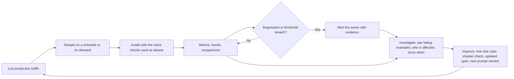

# Production Monitoring for Prompts — Vision & Requirements

> **Status: DRAFT v0.1 — working document.**
> Written for a product audience: it describes *what we want and why*, not how to build it. No implementation plan, architecture, or technology choices belong here.
> Callouts marked **Open question** are decisions we still need to make. Requirement priorities are proposals, not commitments.

---

## 1. Why this document exists

Prompt Studio can tell us whether a prompt is good **before** it ships. Once it ships, we are largely blind. A prompt that passed every check at release can quietly get worse as real users, real data, upstream model changes, and new product surfaces push on it — and today the usual way we find out is a complaint.

We have started closing that gap with **Online Evaluation**: running the same checks that approved a prompt against real production conversations. It works, and teams can use it today, but it is a first step — a recurring pass-rate check — not yet a monitoring system someone can rely on to *tell them when something is wrong*.

This document does three things:

1. Records **what is already in place** for online evals, in plain language (section 3).
2. States the **overarching vision** for production monitoring (section 4).
3. Breaks that vision into a **detailed feature and requirement breakdown** (section 6) that can be prioritised, scoped, and handed to teams.

---

## 2. Who this is for

| Who | What they need from production monitoring |
|---|---|
| **Prompt owner** (the person responsible for a prompt in production) | To know quickly when their prompt got worse, and *why*, without reading thousands of conversations. |
| **AI quality / eval specialist** | To tune what is checked, how often, and on what sample; to trust that the numbers mean what they say. |
| **Product / business owner of the feature the prompt powers** | A plain-language answer to "is this still working well for our users?" |
| **Leadership / platform owner** | A portfolio view: which production prompts are healthy, which are unmonitored, what monitoring costs. |
| **Reviewer / approver** | Evidence from live behaviour when approving the *next* version of a prompt. |

---

## 3. What is in place today

*(Current-state facts, checked against the product as of this draft. "Online Evaluation" below means running a prompt's checks on real production conversations instead of test data.)*

### What a user can do now

- **Run an eval against real traffic on demand.** From a saved eval configuration, choose a time window (up to 7 days back) and a number of production conversations (up to 250). The eval grades what the prompt *actually answered* in production — it does not re-run the prompt.
- **Put an eval on a schedule.** Turn on a recurring online run for an eval configuration. It currently runs **every 6 hours**, looks at the **last 6 hours** of traffic, and grades up to a chosen number of conversations (1–250).
- **See a pass-rate trend.** A "Scheduled" view shows a pass-rate-over-time chart (with the change versus the previous run) and a history of runs. Each point opens the detailed results.
- **Be warned before running.** A pre-run check tells the user which checks *cannot* be evaluated on live traffic and why — mostly checks that need a known "right answer", which production traffic does not have.
- **Grade real speed and cost.** Production latency and cost of each conversation are available to checks.
- **Be told when monitoring itself breaks.** Notifications go out when a scheduled run fails, and when a schedule is switched off automatically.
- **See which prompt versions have live traffic.** The Prompt Library shows how many production conversations each version had over the last 10 days.
- **Protected by default.** Personal information in production conversations is scrubbed before any conversation is reused.

### Safeguards that exist today (intentional, and worth keeping the *intent* of)

- A schedule can only be turned on after at least one successful offline run.
- A schedule switches itself off after 14 days so forgotten monitoring doesn't run (and cost money) forever, and the last editor is notified.
- A schedule is switched off if its eval or prompt version is no longer active.

### Limits today (the gaps this vision addresses)

| Area | Limit today |
|---|---|
| **Frequency** | Fixed at every 6 hours; not configurable. |
| **Volume** | At most 250 conversations per run. |
| **Sampling** | Always the *most recent* conversations in the window — not a random or representative sample. The upstream tracing system also keeps only a fraction of traffic (roughly a fifth to a third), so every result is a partial view, and the product does not say so. |
| **Metrics** | One number per run: how many tests passed out of how many. No per-check breakdown over time, no latency/cost trends, no comparison between versions or against the release baseline. |
| **Alerting** | We are alerted when monitoring *breaks*, never when quality *drops*. A fall from 95% to 40% raises no alert. |
| **Scope of view** | One chart per eval configuration. No view across prompts or projects. |
| **Classification prompts** | Can't be graded properly online: they need a known correct label, which production traffic doesn't have. |
| **Who the conversation belongs to** | No way to group or filter by user. A conversation identifier travels with each graded conversation, but there is no monitoring view built on it. |
| **Longevity** | Monitoring stops after 14 days unless someone re-enables it. |
| **Closing the loop** | A failing production conversation cannot yet be turned into a permanent test case or a new check in a single step. |
| **Coverage** | Nothing tells us which production prompts are *not* being monitored. |

---

## 4. The vision

> **Every prompt running in production is continuously and cheaply checked against the same bar that approved it. We find out about a quality drop before our users do, we can see exactly where and for whom it is happening, and every failure we find makes the next version better.**

### Principles

1. **One yardstick.** The checks that gate release are the checks that watch production. "Did we ship something good" and "is it still good" are answered the same way.
2. **Tell me when it matters; stay quiet when it doesn't.** Monitoring earns trust by alerting on real regressions, with enough evidence to act, and not crying wolf.
3. **Honest numbers.** Every metric states what it is based on — how much traffic existed, how much was graded, how it was sampled — so nobody mistakes a thin sample for certainty.
4. **Cost is a first-class setting, not a surprise.** More frequent, larger, or model-graded monitoring costs money. Users see and control that trade-off up front.
5. **A sample is not the whole picture.** Automated grading only catches what it was built to look for. Monitoring must make it easy to *read* real, ungraded traffic as well (see [process-playbook/05](../process-playbook/05-continuous-quality-and-feedback-loop.md)).
6. **Findings become improvements.** A failure seen in production should be one confirmed step from becoming a test case, a sharper check, or a clearer requirement — never a note that gets lost. Nothing is changed silently; a person confirms.
7. **Privacy by default.** Real conversations and the people in them are protected in every stage, including any new identifiers and labels.
8. **Meet each prompt where it is.** A prompt that writes headlines, one that classifies requests, and one that holds a multi-turn conversation are monitored differently; the product shouldn't force them all through one shape.

### How it works end to end

---

## 5. Capability map

| # | Capability area | One-line promise |
|---|---|---|
| 1 | **Cadence & scheduling** | Run as often as the prompt's risk deserves — and choose it. |
| 2 | **Volume & sampling** | Look at enough of the right traffic, and say clearly how much. |
| 3 | **Metrics & insights** | See how a prompt is doing now, how that's changing, and how it compares. |
| 4 | **Focus ("double down")** | Zoom into any one eval or check and see it in depth. |
| 5 | **Classification prompts & reference answers** | Monitor prompts whose job is to choose a category, without a human labelling everything. |
| 6 | **Identity & segmentation** | Know whose conversations are affected and whether a problem is concentrated. |
| 7 | **Alerts & thresholds** | Be told when quality drops, not just when monitoring breaks. |
| 8 | **Coverage & readiness** | Know what is *not* monitored, and what can't be monitored yet. |
| 9 | **Closing the loop** | Turn production findings into permanent improvements. |
| 10 | **Governance, privacy & cost** | Keep it safe, auditable, and affordable. |

---

## 6. Detailed requirements

**How to read these:** each block has an ID, a one-line requirement, and notes on what "good" looks like.
**Today** = status against what is in place now: **In place** · **Partial** · **New**.
**Priority (draft)** = **Must** · **Should** · **Could**, meant as a starting point for discussion.

---

### 6.1 Cadence & scheduling

**CAD-1 — Configurable frequency** · Today: **Partial** (fixed at 6 hours) · Priority: **Must**
The user can choose how often an eval runs against production, per eval, from sensible presets (for example: every 15 minutes, hourly, every 6 hours, daily, weekly), with a custom option later.
- The more frequent options show their estimated cost before the user confirms.
- High-risk prompts can be watched closely; low-risk prompts can be checked weekly.

**CAD-2 — No gaps, no double-counting** · Today: **Partial** · Priority: **Must**
Each run covers the traffic since the previous run, so changing frequency never causes traffic to be missed or counted twice.
- If a run is late or fails, the next one catches up on the missed period rather than silently skipping it.

**CAD-3 — Monitoring does not silently lapse** · Today: **Partial** (auto-off after 14 days) · Priority: **Should**
Keep the intent of today's safeguard (no forgotten, costly monitoring), but replace "silently switches off" with a deliberate lifecycle.
- Monitoring on a prompt that is live in production is expected to *stay* on.
- Owners get a reminder to renew or retire it before it expires, not a notice afterwards.
- Monitoring ends automatically when the prompt version is retired.

> **Open question:** Should production monitoring default to *on for any published prompt that has traffic*, rather than something each owner has to remember to enable?

**CAD-4 — Run on demand and on events** · Today: **Partial** (on-demand manual run exists) · Priority: **Should**
Beyond the schedule, a user can run now, and monitoring can be set to run extra checks at moments that matter — for example, right after a new version starts receiving traffic.

**CAD-5 — Sensible gate to turn on** · Today: **In place** (needs a successful offline run first) · Priority: **Should**
Keep a "prove it works offline first" expectation, so monitoring is never switched on for an eval that has never passed.

---

### 6.2 Volume & sampling

**VOL-1 — Choose how many conversations to grade** · Today: **Partial** (1–250) · Priority: **Must**
The user chooses how many conversations to grade per run, with a higher ceiling than today (target number "X" to be agreed).
- The product shows the estimated cost and run time at the chosen number.
- Lowering the number is always allowed; raising it past an agreed level may need approval (see GOV-5).

> **Open question:** What is X? Is it a flat number, a percentage of traffic, or "as many as the budget allows"?

**VOL-2 — Choose how traffic is sampled** · Today: **New** (only "most recent" today) · Priority: **Should**
The user can pick how the sample is drawn, with a clear explanation of each:
- **Most recent** — simplest; what we have today.
- **Random** — a fair cross-section of the period.
- **Balanced across groups** — make sure small but important groups (a language, a customer type, a rarely used feature) are represented.
- **Focused on trouble** — over-sample traffic more likely to be a problem (slow, expensive, previously flagged).

**VOL-3 — Honest coverage statement on every result** · Today: **New** · Priority: **Must**
Every result says, in plain words: how much traffic there was, how many conversations were sampled, how many were actually graded, how many were left out and why, and that the underlying traffic record itself may be incomplete.
- No pass rate is ever shown without the size of the sample behind it.

**VOL-4 — Statistical honesty** · Today: **New** · Priority: **Should**
Small samples are labelled as such. A "100%" from 4 conversations is not presented the same as a "100%" from 400.
- Where it helps, show a range ("between 88% and 97%") rather than a single number.
- Alerts (ALR-*) respect a minimum sample size before firing.

**VOL-5 — Volume guardrails** · Today: **New** · Priority: **Should**
Budgets and caps per eval and per team, with a warning as usage nears the cap (see GOV-5).

---

### 6.3 Metrics & insights

**INS-1 — A monitoring home for each eval** · Today: **Partial** (pass-rate chart for scheduled runs) · Priority: **Must**
One page per monitored eval answering: *Is it healthy right now? How has it been trending? How much traffic is this based on? When did it last run and when is it next?*
- Works for every online run type (scheduled, on demand), not only scheduled.

**INS-2 — Per-check breakdown** · Today: **New** · Priority: **Must**
Results are broken down by the individual check (assertion), over time — not just one overall pass rate.
- The user can see *which* requirement is slipping, not just that "something" is.
- Checks are grouped the way the Spec groups them, so results speak the product owner's language.

**INS-3 — Real speed and cost over time** · Today: **New** (values are checkable, but not trended) · Priority: **Should**
Production latency and cost per conversation are shown as trends alongside quality (average and the slow tail), per prompt version.

**INS-4 — Comparisons** · Today: **New** · Priority: **Must**
Put numbers in context. At minimum:
- **Production vs. release** — how does live behaviour compare with the pass rate that approved this version?
- **Version vs. version** — is the new version better or worse in production than the old one?
- **This period vs. a previous period.**

**INS-5 — Failure explorer** · Today: **Partial** (detailed results can be opened per run) · Priority: **Must**
From any metric, see the failing conversations: what the user asked, what the prompt answered, which check failed and why.
- Filter by check, by failure pattern, by time, by segment (IDN-*).
- Group similar failures so a pattern shows up once, with a count, rather than 40 separate rows.
- Show conversations the way a person would read them, not as raw data.

**INS-6 — Portfolio view** · Today: **New** · Priority: **Should**
A single view across all prompts in production: what is monitored, what is healthy, what is degrading, who owns it, what it costs. This is the leadership and platform-owner entry point.

**INS-7 — Time ranges, filters, and export** · Today: **New** · Priority: **Should**
Any metric can be viewed over a chosen time range and filtered by prompt version and segment, and exported for reports.

---

### 6.4 Focus: zoom in on a specific eval or check

"Double down" here means **zooming in**: a user can pick one eval, or one check inside it, and look at it in depth, separately from the overall picture.

**FOC-1 — Deep dive on a single eval or check** · Today: **New** · Priority: **Should**
Open any one eval, or any one check within it, and get a dedicated view: its history, its failures, who is affected, how it compares across versions.
- Reachable in one step from any overall metric ("this check is dragging the pass rate down — show me").
- Everything in 6.3 (trends, comparisons, failure explorer) is available scoped to just that check.

**FOC-2 — Watchlist** · Today: **New** · Priority: **Could**
Pin the handful of checks that matter most (for example, "never states a false policy") to a short list, each with its own threshold and its own notification.

---

### 6.5 Classification prompts & reference answers

> **Words used in this section**
> - **Classification prompt** — a prompt whose job is to *choose* from a fixed set of options rather than write free text.
> - **Category** — one of the options the prompt can choose.
> - **Reference answer** — the correct category for a conversation (the term used elsewhere in these docs).
> - **Labeller** — a separate, fast and inexpensive model that independently gives its own answer, as a second opinion.
> - **Suggested reference answer** — the labeller's answer. **Confirmed reference answer** — one a person has checked.
>
> (Not to be confused with the free-form reviewer labels people attach to results in the Results page.)

#### 6.5.1 The problem

Many prompts don't write — they *decide*: which category a request belongs to, whether a message is urgent, which route a conversation should take, whether a lead is qualified. These decisions usually sit **upstream of everything else**, so when one quietly gets worse, the damage spreads (wrong routing, wrong follow-up, wrong reporting) and nobody sees a bad *sentence* to complain about.

Judging a classification prompt means comparing its choice with the **correct** choice. In testing we have those correct answers written down. In production, nobody has written them. So today these prompts cannot be meaningfully graded online: the checks that matter most need an answer key that live traffic doesn't have.

**The idea:** create the missing answer key *cheaply*, a piece at a time, and be honest about how far each piece can be trusted.

**The governing principle: a model's answer is evidence, not truth.** It is only useful once we know how far to trust it — and that trust must be visible wherever the answer is used.

#### 6.5.2 What counts as a classification prompt

The product should cover the common shapes, and make clear which one a given prompt is:
- **Yes / no** — "Is this a pricing question?"
- **Pick one of several** — "Phone, email, or text?"; "Which service category?"
- **Pick one, with an 'other / none' option.**
- **Pick several** — more than one category can apply.

Illustrations already exist in the prototype's Results-page scenarios (a pricing-help detector, a contact-preference classifier, and a 100-row category/lead classifier), all evaluated offline against reference answers. This section is about carrying that same kind of eval into production.

#### 6.5.3 Three levels of monitoring

These stack, but each is useful on its own — and they follow the same "cheapest first" logic as the assertion tiers (EVAL-1): use the free signal first, the cheap model next, people last.

| Level | What happens | What it needs | What we can honestly say | Cost |
|---|---|---|---|---|
| **1. Watch the answers** | Track what the prompt is choosing: the mix of categories over time, how often its output isn't a valid category, and sudden shifts. | Nothing extra — no answer key. | "Something has changed." (Not yet: "something is wrong.") | Near zero |
| **2. Second opinion** | A labeller independently answers a sample of production conversations; compare with the prompt's choice. | A labeller, and enough trust in it (6.5.5). | "In these conversations the prompt is probably wrong; the two agree X% of the time." | Low, per sampled conversation |
| **3. Confirmed** | People confirm a small sample, starting with the disagreements. | Reviewer time. | "Accuracy is about X%, somewhere between A and B." | Highest, but small and targeted |

Level 1 should be **on by default** for any classification eval. Levels 2 and 3 are opt-in.

#### 6.5.4 The second opinion: how the labeller fits in

Principles for how the labeller behaves, in product terms:

- **Independent.** The labeller sees the (privacy-scrubbed) conversation and the list of categories with their definitions. It does **not** see what the production prompt answered, so it cannot simply agree.
- **Allowed to say "can't tell".** Unsure answers are neither agreement nor disagreement; they are sent to people.
- **One source of truth for definitions.** Category definitions come from the prompt's own description of its categories (and the Spec), not a second copy somebody must keep in sync. If the labeller is inconsistent, that is often a sign the categories are poorly defined — itself a valuable finding.
- **Cheap by design.** A fast, inexpensive model, run on a *sample* rather than all traffic, with the estimated cost shown beforehand.
- **Two jobs, one mechanism.** (1) *Monitor*: how often the labeller and the prompt agree, over time. (2) *Pre-label*: pre-fill a suggested answer for people reviewing, so they confirm or correct instead of labelling from scratch — which is also how we cheaply build up test cases from real traffic.
- **Never replaces people.** Its job is to decide *where people should look*.

#### 6.5.5 Earning trust

A labeller must prove itself before its numbers mean anything.

- **A report card, before it touches production.** When a labeller is attached, it first answers the classification eval's **existing test cases**, which already have reference answers written by people. The product shows how often it matches. This costs no extra human effort. *Limit:* test sets are usually tidier than real traffic, so this is necessary but not sufficient.
- **Confirmation on real traffic.** Agreement is then measured against reference answers people have confirmed from production. An earlier team discussion about bounded judge calibration suggested a small number of confirmed items — on the order of 20–30 — as a starting point ([`spec-driven-redesign/06`](../spec-driven-redesign/06-sdd-alignment-and-resolutions.md)). Treat that as a figure to test, not a rule.
- **A trust badge on every number that depends on a labeller**, for example: *"The labeller agrees with people 94% of the time (60 confirmed examples, last checked 3 days ago)"* — with a clear state: **Not yet verified**, **Verified**, or **Slipping**.
- **Trust expires.** Changing the labeller, changing the categories, or a noticeable shift in traffic triggers a fresh check.
- **When trust is low, say so.** Low-trust numbers are shown as *indicative only*, with the reason, and do not drive hard alerts by default.
- **Don't assume the labeller is as capable as the prompt.** A cheap model may be weaker than the model whose answers it checks. The report card and human confirmation are the safeguard, not an assumption.

#### 6.5.6 A worked example *(illustrative — numbers invented)*

A prompt reads a customer's message and decides how they prefer to be contacted: phone, email, text, or no preference.

1. **Day one.** The owner turns on monitoring. Level 1 starts immediately and shows the mix of answers — say, mostly phone and email, a small share "no preference" — as the baseline.
2. **Add a second opinion.** The owner attaches a labeller. Its report card on the eval's 100 existing test cases shows it matches the human answers 96% of the time; the owner sees the estimated cost per 1,000 labels and switches it on.
3. **Every run,** the labeller answers a sample of conversations — deliberately including enough of the rare categories — and the product shows how often it agrees with the prompt.
4. **Two weeks later** "no preference" has roughly doubled and agreement has fallen from the low 90s to around 80%. The owner is alerted, with examples, and the disagreements cluster in one language segment (IDN-4).
5. **A reviewer** opens a short queue of the disagreements, sees the labeller's suggestion pre-filled, and confirms most of them as prompt errors. In one step, those conversations — scrubbed of personal information — become new test cases. The owner now has real evidence and real test cases to fix the prompt, and the labeller's trust figure is updated with the newly confirmed examples.

#### 6.5.7 What the user sees on a classification eval's monitoring page

In reading order:
1. **Mix of answers over time**, compared with the mix at release.
2. **Invalid / "other" rate.**
3. **Second-opinion agreement trend**, with its trust badge and the number of conversations it is based on.
4. **Where they disagree** — "the prompt said A where the labeller said B" — so a systematic confusion stands out.
5. **Review queue** — how many items wait, how many are confirmed so far.
6. **Estimated accuracy** once enough answers are confirmed, shown as a range with its sample size.
7. **Coverage and cost to date** (per VOL-3 and GOV-5).

#### 6.5.8 Hard cases the product must handle honestly

- **Genuinely borderline conversations.** Two reasonable people can disagree. A disagreement is a place to *look*, not automatically an error; reviewers can mark an item as ambiguous.
- **A new kind of request that fits no category.** When a new type of traffic appears, the prompt is forced into a wrong choice. This is one of the most valuable things monitoring can find: surface conversations that don't fit any category as a possible *new* category.
- **Rare categories.** A plain random sample will barely include them, so a failing rare category goes unseen. The labelling sample must guarantee a minimum per category. And since a category the prompt *never* chooses is invisible to a sample drawn from the prompt's own answers, part of the sample must be drawn at random.
- **Information the labeller doesn't have.** If the prompt's decision relies on facts outside the conversation (account details, history), the labeller can't reproduce it. The owner can mark an eval as unsuitable for a second opinion; Levels 1 and 3 still apply.
- **What exactly is being classified in a multi-turn conversation?** The whole conversation or the latest message? This must be unambiguous (see the *unit of evaluation* question in 6.6).
- **Languages and channels.** A labeller may be weaker in some. Trust is shown per segment where there is enough data.
- **Both wrong in the same way.** The prompt and the labeller can share a blind spot. The only safeguard is a random sample confirmed by people, which is why Level 3 never goes away.
- **Privacy.** The labeller only sees scrubbed conversations, and suggested/confirmed answers are stored under the same rules as everything else (GOV-1).

#### 6.5.9 Requirements

**CLS-1 — Watch the answers (Level 1)** · Today: **New** · Priority: **Must**
For any classification eval, show the mix of categories chosen over time and the share of invalid outputs, with no labelling required. On by default.
- The product knows which categories are valid, taken from the eval or prompt, so "invalid" is well defined.

**CLS-2 — Shift against baseline** · Today: **New** · Priority: **Must**
Compare the current mix of answers with the mix at release (or the first stable period), flag meaningful shifts, and allow an alert on them (ALR-*).
- "Meaningful" accounts for sample size (VOL-4).

**CLS-3 — Attach a labeller** · Today: **New** · Priority: **Should**
An owner can attach a fast, inexpensive labeller to a classification eval, separate from the prompt's own model, and swap it later.
- The estimated cost per 1,000 labels is shown before switching it on.

**CLS-4 — Independent, honest labelling** · Today: **New** · Priority: **Must** *(if CLS-3)*
The labeller does not see the prompt's production answer, works from the categories' definitions, and may answer "can't tell". "Can't tell" never counts as agreement or disagreement.

**CLS-5 — Report card before use** · Today: **New** · Priority: **Must** *(if CLS-3)*
Before a labeller is used on production traffic, the product runs it on the eval's existing test cases and shows how often it matches the human reference answers. The owner sees this before switching it on.

**CLS-6 — Trust badge on every labeller-based number** · Today: **New** · Priority: **Must** *(if CLS-3)*
Every metric that depends on a labeller shows its trust: agreement with confirmed answers, how many confirmed examples that is based on, when it was last checked, and its state (not yet verified / verified / slipping).

**CLS-7 — Low-trust behaviour** · Today: **New** · Priority: **Must** *(if CLS-3)*
When trust is low or unknown, labeller-based numbers are labelled *indicative only*, with the reason, and do not trigger hard alerts by default.

**CLS-8 — A separate, smarter labelling sample** · Today: **New** · Priority: **Should**
How many conversations are labelled is chosen separately from how many are graded, with a cost cap. The sample guarantees a minimum for each category and includes a random portion, so rare and never-chosen categories aren't missed.

**CLS-9 — Agreement and disagreements** · Today: **New** · Priority: **Should**
Show the agreement trend, and list disagreements as the places to look — not as failures by default.

**CLS-10 — Review queue with pre-filled suggestions** · Today: **New** · Priority: **Should**
A short queue of disagreements, "can't tell" items, and a random slice. The labeller's suggestion is pre-filled, and a reviewer confirms, corrects, or marks it ambiguous in one step.

**CLS-11 — Confirmed answers feed back** · Today: **New** · Priority: **Should**
A confirmed conversation can be added to the eval's dataset (scrubbed of personal information) and to the labeller's trust set in one step.

**CLS-12 — Accuracy estimate from confirmed answers (Level 3)** · Today: **New** · Priority: **Should**
Once enough answers are confirmed, show an estimated accuracy as a range, with the number of confirmed examples it rests on, and make plain that it is an estimate.

**CLS-13 — Emerging-category detection** · Today: **New** · Priority: **Should**
Surface conversations that don't fit any existing category, and groups of them, as a possible new category.

**CLS-14 — Where it goes wrong** · Today: **New** · Priority: **Could**
A view of "prompt said A, labeller or people said B" so a systematic confusion between two categories stands out. Per-category quality where enough confirmed answers exist.

**CLS-15 — Versioned answers, refreshed trust** · Today: **New** · Priority: **Should**
Every suggested answer records which labeller and version produced it. Changing the labeller marks a break in the trend and triggers a new report card, so history is never silently rewritten.

#### 6.5.10 Decisions needed

1. **The trust bar.** What level of agreement with people makes a labeller "verified"? One product-wide default, or set by each owner (with a default)?
2. **The cost ceiling.** What is acceptable to spend on labelling per eval per month, and who approves going over?
3. **Calibration.** The prototype *removed* judge calibration as too complex ([EVAL-7](../requirements/03-assertions-and-judge.md#eval-7--judge-calibration)), while calling it "a valid future direction". This section proposes a deliberately lighter version: the **report card** is automatic and costs the user nothing, and **confirmation** happens naturally through the review queue. Is that light enough, or still too much?
4. **Is human confirmation required** before labeller-based numbers are shown as "verified", or is the report card alone enough for a first release?
5. **Scope.** Does the same approach apply to other "judgement" prompts (tone, safety, relevance), or only to classification?
6. **Definitions.** Are category definitions reliably available in today's prompts and evals? If not, owners must write them — which is extra work but also a quality gain.
7. **Who reviews, and how much time.** Prompt owners, a dedicated reviewer role, or domain experts? What weekly time is realistic?
8. **Low-trust behaviour.** Show numbers as "indicative only" (as drafted) or hide them until verified?

---

### 6.6 Identity & segmentation

**The problem in plain terms.** "Pass rate fell 8 points" is much more useful as "pass rate fell 8 points, and it's almost entirely three users in one market", or "...only on conversations that started in the mobile app." Today we can't say that.

**IDN-1 — Every graded conversation can be attributed** · Today: **Partial** (conversation identifier carried, not exposed) · Priority: **Must**
Every graded conversation carries the best identifier available, and the product says which kind it is:
1. **User identifier** — when the calling product knows who the user is.
2. **Conversation / chat identifier** — when there is a conversation but not a known user.
3. **Anonymous or session identifier** — a fallback for everything else.
- The identifier type is visible, so no one mistakes a chat ID for a person.

**IDN-2 — Group and filter by identifier** · Today: **New** · Priority: **Should**
Filter and group results by user or conversation, to answer: *Is this concentrated in a few users? Is one user having a bad time repeatedly?*

**IDN-3 — Jump from a result to the original conversation** · Today: **New** · Priority: **Should**
From a failing result, open the full conversation in the source product (subject to permissions) to see context a single response can't show.

**IDN-4 — Segments beyond identity** · Today: **New** · Priority: **Should**
Break down results by tags the calling product supplies — for example customer type, market, language, channel, model used, prompt version.
- Which tags are available is configurable per prompt.

**IDN-5 — Privacy for identifiers** · Today: **New** · Priority: **Must**
Identifiers get the same protection as the conversation text: stored only as long as needed, visible only to people who should see them, with an option to pseudonymise, and honoured when a user asks for their data to be deleted.

> **Open questions**
> - What is the "unit" being graded — a single response, or an entire multi-turn conversation? Different prompts need different answers, and it changes what an identifier means.
> - Which calling products can supply a user identifier today, and which can only supply a chat ID?
> - Who is allowed to see identifiers at all?

---

### 6.7 Alerts & thresholds

**ALR-1 — Quality thresholds** · Today: **New** · Priority: **Must**
An owner sets a minimum acceptable level for an eval or a single check (for example "below 90% is a problem") and is alerted when live results cross it.

**ALR-2 — Regression detection** · Today: **New** · Priority: **Must**
An owner is alerted when quality *drops meaningfully compared with a baseline* — the release pass rate, or the recent trend — even if it stays above the absolute threshold.
- "Meaningfully" accounts for sample size and normal noise, to avoid false alarms (VOL-4).

**ALR-3 — Right person, right channel, right urgency** · Today: **Partial** (failure notices go to the last editor) · Priority: **Must**
Alerts go to the prompt's owner (not just whoever edited last), by the owner's chosen channel, with a severity. Options for immediate vs. daily digest.

**ALR-4 — Alerts carry the evidence** · Today: **New** · Priority: **Must**
An alert says: what dropped, by how much, since when, how many conversations support it, and links straight to examples of the failures (INS-5). No alert should require the owner to start an investigation from scratch.

**ALR-5 — Monitoring-health alerts** · Today: **Partial** (failed run, auto-off) · Priority: **Should**
Keep today's notices, and add: "this prompt stopped receiving traffic", "coverage dropped", "no run has succeeded in N intervals".

**ALR-6 — Acknowledge, snooze, resolve** · Today: **New** · Priority: **Should**
Owners can acknowledge an alert, snooze it with a reason, and see its history, so alerts don't become a source of noise or lost context.

> **Open question:** Do alerts ever take action — for example, flag the version in the approval screen, or suggest rolling back? Or are they strictly informational?

---

### 6.8 Coverage & readiness

**CVG-1 — "What isn't being watched?"** · Today: **New** · Priority: **Must**
A list of prompt versions that are receiving production traffic but have **no** monitoring, and monitored prompts whose traffic can't be seen (for example because the calling application isn't tagging its requests).
- Each item says what to do next.

**CVG-2 — Know up front what can be checked live** · Today: **Partial** (pre-run warnings exist) · Priority: **Should**
Keep the pre-run warning that says which checks can't be evaluated on live traffic and why, and add guidance for each: what to use instead.
- Where a check needs a known right answer, point to the labelling options in 6.5.

**CVG-3 — Read ungraded traffic too** · Today: **New** · Priority: **Should**
A way to read a random sample of real conversations that **no check has graded**, with note-taking, to find the failure patterns no check yet knows to look for.
- This is the part of the sample that automated grading will never reveal ([playbook](../process-playbook/05-continuous-quality-and-feedback-loop.md#1-keep-watching-after-launch)).

**CVG-4 — Setup guidance** · Today: **Partial** (an external how-to exists) · Priority: **Could**
In-product guidance for getting a prompt ready to be monitored, so teams don't need to hunt for a separate document.

---

### 6.9 Closing the loop

**LOOP-1 — Production conversation → permanent test case** · Today: **New** · Priority: **Must**
From any failing (or interesting) production conversation, add it to the eval's dataset in one step — **with personal information scrubbed first**, because a dataset row, unlike a run result, doesn't expire. (See [`spec-driven-redesign/06`](../spec-driven-redesign/06-sdd-alignment-and-resolutions.md).)

**LOOP-2 — Recurring failure → proposed new check** · Today: **New** · Priority: **Should**
When the same failure pattern keeps appearing, the product proposes a new or sharpened check, drafted and ready for a person to confirm.

**LOOP-3 — Production signal tied back to the Spec** · Today: **New** · Priority: **Could**
Where possible, a production failure points to the requirement in the Spec it violates — or shows that the Spec never covered it, prompting an update to the brief.

**LOOP-4 — Production evidence at the next release decision** · Today: **New** · Priority: **Could**
When someone reviews the next version of a prompt, they see how the current version has actually been doing in production.

---

### 6.10 Governance, privacy & cost

**GOV-1 — Privacy kept end to end** · Today: **In place** (scrubbing before reuse) · Priority: **Must**
Everything new — identifiers, labels, exports, saved examples — is covered by the same privacy protection. Nothing containing unscrubbed personal information is kept longer than needed.

**GOV-2 — Retention** · Today: **Partial** · Priority: **Should**
Clear, visible rules for how long production-derived data is kept, and what is kept in summary form after detail is removed.

**GOV-3 — Permissions** · Today: **Partial** · Priority: **Must**
Clear rules on who can turn monitoring on or off, change thresholds, view conversations, view identifiers, and spend budget.

**GOV-4 — Change history** · Today: **Partial** · Priority: **Should**
Every change to a schedule, threshold, sample, or labeller records who changed it, when, and why.

**GOV-5 — Cost visibility and budgets** · Today: **New** · Priority: **Must**
Each monitored eval shows what it costs per month; teams can set budgets; going past one requires a conscious step, not a surprise bill.

**GOV-6 — Reproducible results** · Today: **New** · Priority: **Should**
Every result can be traced to exactly what produced it: prompt version, version of the checks, labeller version, sample drawn, and time window.

---

## 7. Suggested phasing (outcome-based, for discussion)

Phasing is described by **what users can do**, not by what gets built.

| Horizon | Outcome | Roughly covers |
|---|---|---|
| **1. Trustworthy basics** | An owner can choose how often and how much to check, sees an honest per-check picture, and is alerted when quality drops. | CAD-1/2, VOL-1/3/4, INS-1/2/5, ALR-1/3/4, IDN-1, GOV-1/5 |
| **2. Insight and focus** | An owner can compare versions and releases, zoom into one check, tell who is affected, and monitor classification prompts — first by watching the answers, then with a trusted second opinion. | INS-3/4, FOC-1, ALR-2, IDN-2/3/4, CLS-1/2 (watch the answers), CLS-3 to CLS-10 (second opinion and review), VOL-2, CVG-1/2 |
| **3. Closed loop at scale** | Leadership sees a portfolio view; findings flow into improvements with a click; the system keeps itself current. | INS-6/7, FOC-2, LOOP-1/2/3/4, CVG-3/4, CAD-3/4, CLS-11 to CLS-15 (confirmed answers, accuracy estimates, emerging categories), remaining GOV |

---

## 8. How we will know it's working

*(Draft success measures — to be agreed.)*

- **Coverage:** the share of production prompt versions with active monitoring, versus the total with live traffic.
- **Detection:** how quickly a real quality drop is found, compared with how it was found before (a complaint, an escalation).
- **Alert quality:** the share of alerts that owners judge worth acting on.
- **Trust in the numbers:** where labellers are used, their agreement with human-verified labels.
- **Learning:** the number of production findings converted into permanent test cases or sharper checks each month.
- **Efficiency:** the monitoring cost per prompt, and per issue caught.

---

## 9. Out of scope (draft)

- Replacing offline evaluation or the release approval gate. Monitoring complements them; it does not replace them.
- A general-purpose analytics or observability platform for the whole product. This is about prompt quality.
- Automatically rewriting prompts or checks without a person confirming.
- End-user-facing reporting. Audience is the people who build and own prompts.

---

## 10. Risks to keep in view

| Risk | Why it matters |
|---|---|
| **False confidence** | Small, biased, or partial samples make a prompt look healthier or sicker than it is. Coverage statements (VOL-3, VOL-4) are the main defence. |
| **Alert fatigue** | If early alerts are noisy, owners stop reading them. Quality of alerts matters more than the number of them. |
| **Cost creep** | More frequency, more volume, and model-based labelling multiply cost. Budgets and cost previews must arrive with the capability, not after. |
| **Weak labellers** | A cheap model that's wrong makes the numbers wrong. Labeller trust (CLS-5, CLS-6, CLS-7) is a condition of using a labeller at all, not an extra. |
| **Privacy exposure** | Adding user identifiers and saved examples increases what could leak. GOV-1 and IDN-5 are gating. |
| **Instrumentation gaps** | Monitoring only works where calling applications tag their traffic. Coverage tracking (CVG-1) makes the gap visible. |
| **Existing docs contradict reality** | Some current docs still describe Online Evaluation as "not built." Teams will read mixed messages until those are updated. |

---

## 11. Open questions — consolidated

1. **How frequent is frequent enough?** Is "every 15 minutes" a real need, or is hourly the practical floor? (CAD-1)
2. **What is X?** The new ceiling for conversations per run, and whether it's a count, a percentage, or budget-driven. (VOL-1)
3. **Should monitoring be on by default** for any published prompt with traffic? (CAD-3)
4. **Classification decisions** (6.5.10, eight in total): the trust bar for a labeller, the cost ceiling, whether to reverse the earlier decision to skip judge calibration, and whether the idea extends beyond classification.
5. **Unit of evaluation:** single response, or whole conversation? (6.6)
6. **Who can see identifiers**, and which calling products can supply a user ID vs. only a chat ID? (6.6)
7. **Do alerts ever trigger action**, or only inform? (6.7)
8. **Who owns a monitored prompt** for alert routing — is there an "owner" field today, or do we need one? (ALR-3)
9. **Which prompts first?** Is there a priority list (highest traffic, highest risk, specific teams) to shape the first horizon?
10. **Anything else the audience needs?** Roles or use cases missing from section 2.

---

## 12. Related documents

- [`process-playbook/05-continuous-quality-and-feedback-loop.md`](../process-playbook/05-continuous-quality-and-feedback-loop.md) — the philosophy this document operationalises.
- [`spec-driven-redesign/05-eval-methodology-best-practices.md`](../spec-driven-redesign/05-eval-methodology-best-practices.md) — error analysis, and CI-style vs. production monitoring.
- [`spec-driven-redesign/06-sdd-alignment-and-resolutions.md`](../spec-driven-redesign/06-sdd-alignment-and-resolutions.md) — privacy rules for promoting real traces into datasets.
- [`requirements/08-library-and-real-data.md`](../requirements/08-library-and-real-data.md) — "build from real data" requirements that overlap with LOOP-1.
- [`prompt-management-docs/03-evaluations.md`](../prompt-management-docs/03-evaluations.md) — what evaluations do today.
